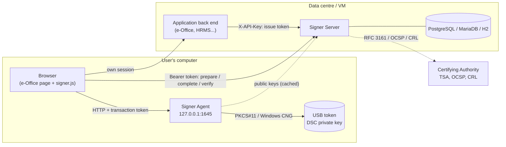
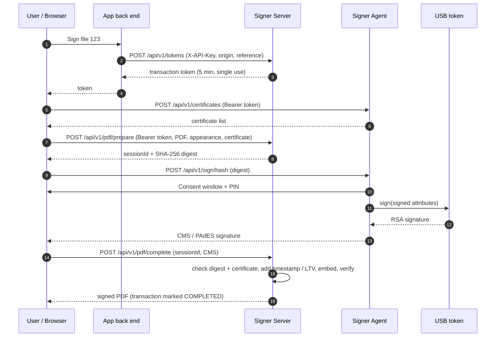
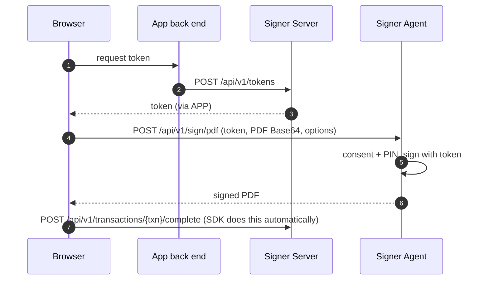

# Architecture

## 1. The problem

Government workflow systems (e-Office and department portals) run in the browser, but Class 3 Digital
Signature Certificates live on USB tokens whose private keys can never be exported. A browser cannot
talk to a USB token directly, so a small program on the user's PC has to bridge the two.

The current APTS set-up ("Browser Signing Solution v4.2.x") works like this:

1. The web application calls `https://www.pki.network/api/v1.0/generatekey` with a secret `authtoken`
   to obtain a one-time transaction token (this is how the vendor licenses and meters usage).
2. The page calls the local EXE at `http://127.0.0.1:1620` with `pkiNetworkCertExt` (list certificates)
   and `pkinetworksign` (sign), sending the token and the **whole PDF as Base64**.
3. The EXE opens the token, signs and returns the signed PDF.

Signer keeps this proven shape but you own every part of it, and it adds a better default mode in which
only a hash goes to the token.

## 2. Components

| Component | Responsibilities |
|---|---|
| **Signer Agent** | Loopback HTTP API; verifies transaction tokens offline (Ed25519); enforces origin binding and single use; lists certificates from PKCS#11 libraries and the Windows certificate store; shows the consent window and collects the PIN; signs PDFs or digests; writes a local audit log. |
| **Signer Server** | Tenants (customer organisations) with allowed web origins, quotas and validity; API keys; issues single-use transaction tokens; server-side PDF preparation and completion; timestamping and LTV; verification; usage reports; admin console; installation licence. |
| **signer-core** | Shared signing engine used by both: PDF appearance, two-phase signing, CMS/PAdES, timestamps, DSS/LTV, verification, tokens, licences. |
| **signer.js** | Browser SDK that hides the HTTP details and orchestrates both signing modes. |

## 3. Signing flows

### 3.1 Server-prepared signing (recommended)

Benefits: the PDF never leaves the server environment, desktop traffic is a few kilobytes, the server
(not the desktop) reaches the timestamp authority and OCSP responders, and the server checks that the
signature belongs to the prepared document before accepting it.

### 3.2 Desktop signing (APTS-compatible model)

### 3.3 Batch signing

`/api/v1/sign/pdf` accepts `documents: [...]` and `/api/v1/sign/hash` accepts `hashes: [...]`. The user
confirms once and enters the PIN once for the whole batch; the token's `maxDocuments` limits the batch.

## 4. Trust model

* **Transaction tokens** are compact JWS objects signed with the server's Ed25519 key. Claims: `jti`
  (transaction id), `sub` (tenant), `origin`, `ops` (`certificates`, `sign`), `max` (documents), `ref`,
  `iat`, `exp`. The agent downloads the public keys from `/.well-known/signer-keys` (or uses keys pasted
  into `agent.properties`) and verifies tokens **offline**, so signing keeps working if the server is
  briefly unreachable after the token was issued.
* A token works only from the **origin it was issued for** (the browser's `Origin` header cannot be forged
  by web pages), only for the permitted operations, only until it expires, and only for `max` documents.
* **API keys** never reach the browser; the server stores only their SHA-256 hash.
* The **private key never leaves the token**: the agent sends the token driver only the DER-encoded
  signed attributes to sign (PKCS#11 `C_Sign` / CNG `NCryptSignHash`).
* Every signature requires an explicit **user confirmation** in a window owned by the agent (website,
  organisation, file reference, documents, certificate), so a malicious page cannot sign silently.

See [SECURITY.md](SECURITY.md) for the full threat model.

## 5. PDF signatures produced

| Item | Value |
|---|---|
| Sub-filter | `adbe.pkcs7.detached` (default, widest compatibility) or `ETSI.CAdES.detached` (PAdES baseline) |
| Digest / signature | SHA-256 with RSA (PKCS#1 v1.5) or ECDSA, as supported by the token |
| Signed attributes | content-type, message-digest, signing-time (PKCS#7) / signing-certificate-v2 (PAdES) |
| Timestamp | RFC 3161 signature timestamp (unsigned attribute) from a configurable TSA |
| LTV | Document Security Store with certificate chain, OCSP responses and CRLs |
| Appearance | Name, date (IST by default), reason, location, free text, optional image and green tick; any page, any position; rotated pages handled |
| Certification | Optional DocMDP level 1-3 for the first signature |
| Incremental | Earlier signatures stay valid; multiple approvers can sign the same file |

## 6. Data model (server)

| Table | Purpose |
|---|---|
| `tenants` | Customer organisations: code, name, plan, monthly quota, validity, allowed origins, status |
| `api_keys` | Hashed API keys per tenant, with last use and revocation time |
| `transactions` | One row per issued token: status (ISSUED / COMPLETED / FAILED), documents, signer, reference, origin, IP. This is the **billing unit**. |
| `signing_sessions` | Server-prepared PDFs waiting for their signature (deleted after expiry) |
| `admin_users` | Console users with bcrypt passwords and ADMIN / VIEWER roles |
| `audit_log` | Administrative actions and logins |
| `settings` | Installed licence and other server-wide settings |

## 7. Technology choices

* **Java 21** for agent and server: the JDK ships PKCS#11 (SunPKCS11) and Windows CNG/CAPI (SunMSCAPI)
  providers, so every Indian DSC token works through its vendor driver without native code; jpackage
  bundles a private Java runtime, so PCs need no separate Java installation. e-Office itself is Java.
* **Apache PDFBox + Bouncy Castle**: mature, permissively licensed (no AGPL obligations as with iText).
* **Spring Boot + plain JDBC + Flyway** for the server: runs on the embedded H2 database for a single VM
  and on PostgreSQL / MariaDB / MySQL in production.
* **Vanilla JavaScript** for the SDK and consoles: no build tool chain, works in any intranet.
